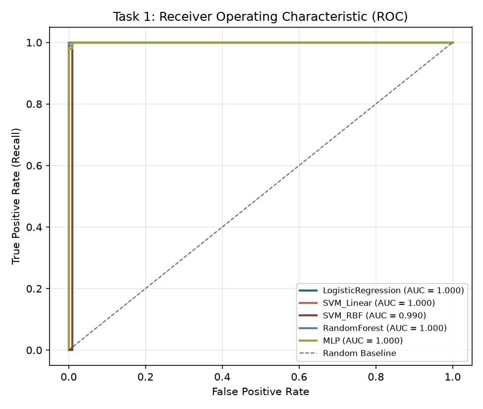
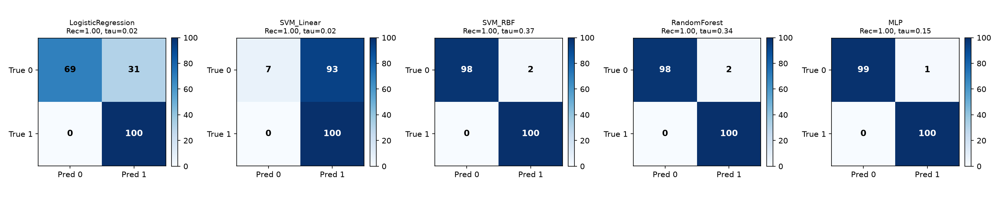
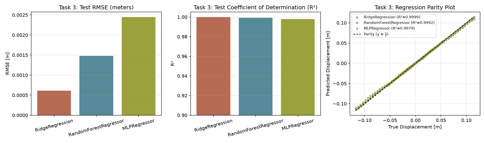
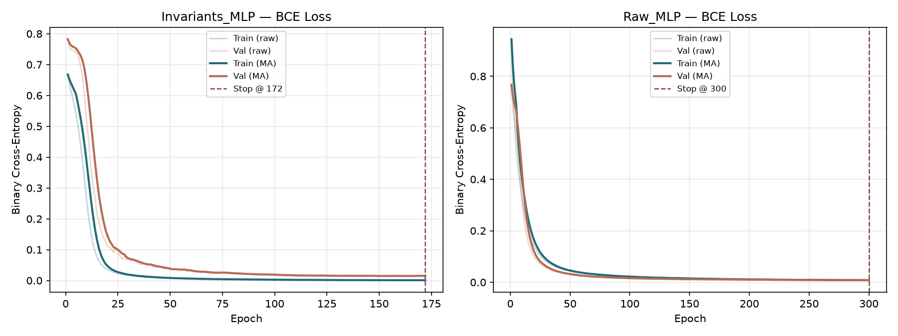

# Project A — Engineering Synthesis Report

## 1. Task 1: Global Anomaly Detection (Engineered Kinematic Invariants)

| Model | Threshold (tau) | Accuracy | Precision | Recall | F1 | ROC-AUC | FN (Missed Damage) | FP (False Alarm) |
| --- | --- | --- | --- | --- | --- | --- | --- | --- |
| LogisticRegression | 0.021 | 0.845 | 0.7634 | 1.0 | 0.8658 | 1.0 | 0 | 31 |
| SVM_Linear | 0.016 | 0.535 | 0.5181 | 1.0 | 0.6826 | 0.9999 | 0 | 93 |
| SVM_RBF | 0.373 | 0.99 | 0.9804 | 1.0 | 0.9901 | 0.99 | 0 | 2 |
| RandomForest | 0.34 | 0.99 | 0.9804 | 1.0 | 0.9901 | 1.0 | 0 | 2 |
| MLP | 0.15 | 0.995 | 0.9901 | 1.0 | 0.995 | 0.9998 | 0 | 1 |

## 2. Feature Engineering Ablation (Raw Displacements vs. Kinematic Invariants)

| model_name | raw_acc | inv_acc | delta_acc | raw_recall | inv_recall | raw_f1 | inv_f1 | delta_f1 | raw_auc | inv_auc | delta_auc | raw_fn | inv_fn |
| --- | --- | --- | --- | --- | --- | --- | --- | --- | --- | --- | --- | --- | --- |
| LogisticRegression | 0.5 | 0.845 | 0.345 | 1.0 | 1.0 | 0.6667 | 0.8658 | 0.1991 | 0.7827 | 1.0 | 0.2173 | 0 | 0 |
| SVM_Linear | 0.5 | 0.535 | 0.035 | 1.0 | 1.0 | 0.6667 | 0.6826 | 0.0159 | 0.2923 | 0.9999 | 0.7076 | 0 | 0 |
| SVM_RBF | 0.94 | 0.99 | 0.05 | 0.99 | 1.0 | 0.9429 | 0.9901 | 0.0472 | 0.9633 | 0.99 | 0.0267 | 1 | 0 |
| RandomForest | 0.98 | 0.99 | 0.01 | 1.0 | 1.0 | 0.9804 | 0.9901 | 0.0097 | 0.998 | 1.0 | 0.002 | 0 | 0 |
| MLP | 1.0 | 0.995 | -0.005 | 1.0 | 1.0 | 1.0 | 0.995 | -0.005 | 1.0 | 0.9998 | -0.0002 | 0 | 0 |

## 3. Task 2: Critical Observability Audit (Defect Localization Defense)

- **Monitored Nodes**: 2
- **Measured DOFs**: 6
- **Measurement Operator Rank Bound**: 6

### Task 2 (Level 2 SHM): Mathematical Proof of Ill-Posedness

1. **Rank-Deficient Observation Operator**:
   Let $u(t) \in \mathbb{R}^{N_{\text{dof}}}$ denote the full 3D lattice space-truss nodal displacement vector ($N_{\text{dof}} \gg 6$). The two-node sensor configuration (pinnacle and cross-arm) defines a linear measurement operator $C \in \mathbb{R}^{6 \times N_{\text{dof}}}$ such that $y(t) = C u(t) \in \mathbb{R}^{6}$. Therefore:
   $$\operatorname{rank}(C) \le 6 \ll N_{\text{dof}}, \qquad \dim(\ker(C)) \ge N_{\text{dof}} - 6.$$

2. **Non-Uniqueness of Stiffness Perturbations (Inverse Problem Indeterminacy)**:
   Under a structural damage perturbation $\Delta K = \sum_{e=1}^{M} \delta_e K_e$ across $M$ truss members, quasi-static equilibrium satisfies $(K_0 - \Delta K) u = f$. Because only $C K(\delta)^{-1} f$ is observed in $\mathbb{R}^{6}$, mapping $M \gg 6$ unknown element damage parameters $\delta \in \mathbb{R}^M$ from at most 6 spatial components is strictly underdetermined. Distinct member fractures at different elevations or opposing truss faces can induce identical macro-compliance changes at the two measured nodes (minimum observed cross-class compliance separation $\Delta \kappa = 0.000082$).

3. **Absence of Spatial Strain Gradients**:
   Localizing damage to an elevation tier or truss quadrant requires spatial derivatives $\nabla u$ (strain fields) or higher-order vibration mode shapes $\phi_r(x)$ across distributed coordinates. With only two global measurement points, $\nabla u$ along the tower body is unobserved, making Level 2 spatial localization mathematically non-identifiable without denser local instrumentation.

### Empirical Global Compliance Separations (Cross-Class)

| run_a | run_b | label_a | label_b | kappa_diff | top_u1_peak_diff_m | within_tol |
| --- | --- | --- | --- | --- | --- | --- |
| c0_long_1MN | c1_long_1MN | 0 | 1 | 0.001915 | 0.003599 | False |
| c0_long_1MN | c1_long_2MN | 0 | 1 | 0.004408 | 0.099895 | False |
| c0_long_2MN | c1_long_1MN | 0 | 1 | 0.00066 | 0.089062 | True |
| c0_long_2MN | c1_long_2MN | 0 | 1 | 0.001833 | 0.007233 | False |
| c0_short_1MN | c1_short_1MN | 0 | 1 | 0.003383 | 0.002776 | False |
| c0_short_1MN | c1_short_2MN | 0 | 1 | 0.006547 | 0.061433 | False |
| c0_short_2MN | c1_short_1MN | 0 | 1 | 8.2e-05 | 0.053089 | True |
| c0_short_2MN | c1_short_2MN | 0 | 1 | 0.003246 | 0.005568 | False |

### Required Sensor Modalities for Level 2 Localization

- Distributed uniaxial/rosette strain gauge arrays along primary leg and diagonal bracing tiers
- Multi-elevation triaxial accelerometer network for mode-shape curvature and modal strain energy
- Fiber Bragg Grating (FBG) optical strain sensing along critical load-transfer paths
- Full-field Digital Image Correlation (DIC) for localized spatial displacement gradients

## 4. Task 3: Top-Node Displacement Prediction (System Identification)

| Model | Test MSE [m^2] | Test RMSE [m] | Test R^2 |
| --- | --- | --- | --- |
| RidgeRegression | 3.7622e-07 | 0.000613 | 0.99987 |
| RandomForestRegressor | 2.1905e-06 | 0.00148 | 0.999242 |
| MLPRegressor | 5.9985e-06 | 0.002449 | 0.997923 |

## 5. Underfitting-Before-Overfitting Diagnostic Verification

| Model | regime | underfit_resolved | min_train_loss | min_val_loss | final_train_loss | final_val_loss | generalization_gap | stopped_epoch |
| --- | --- | --- | --- | --- | --- | --- | --- | --- |
| Invariants_MLP | well_fitted | True | 0.00078 | 0.013944 | 0.00078 | 0.015358 | 0.014577 | 172 |
| Raw_MLP | well_fitted | True | 0.007719 | 0.007712 | 0.007719 | 0.008203 | 0.000484 | 300 |

