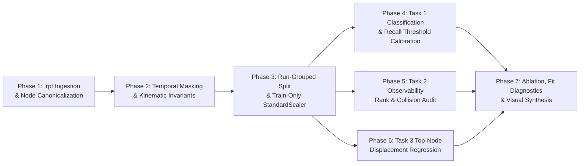
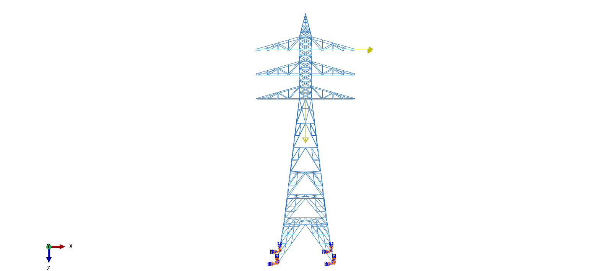
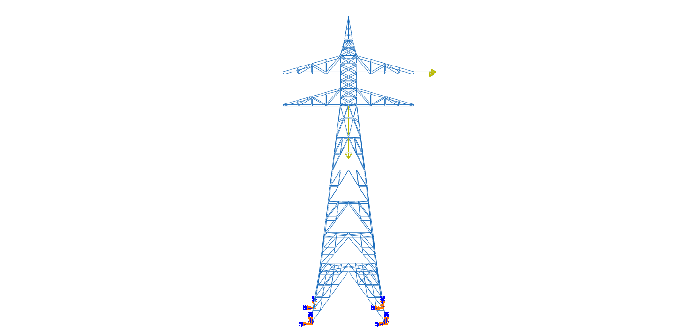
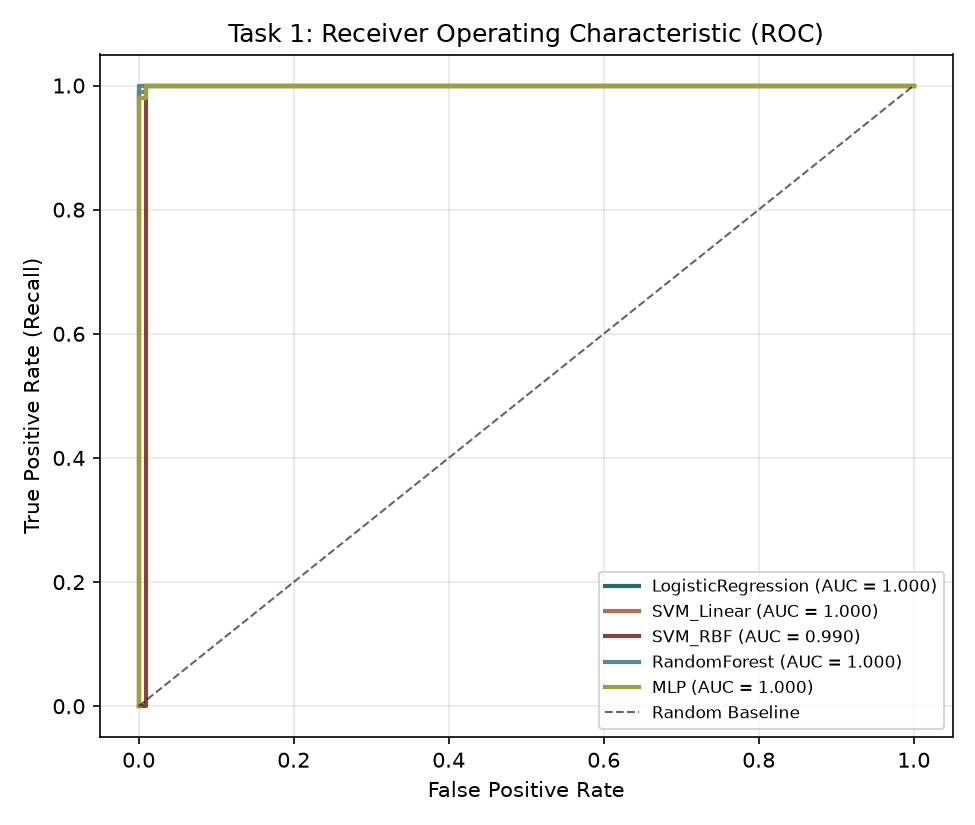
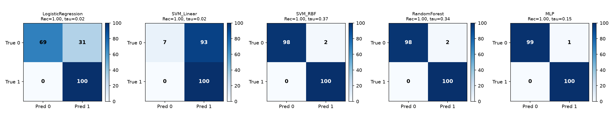
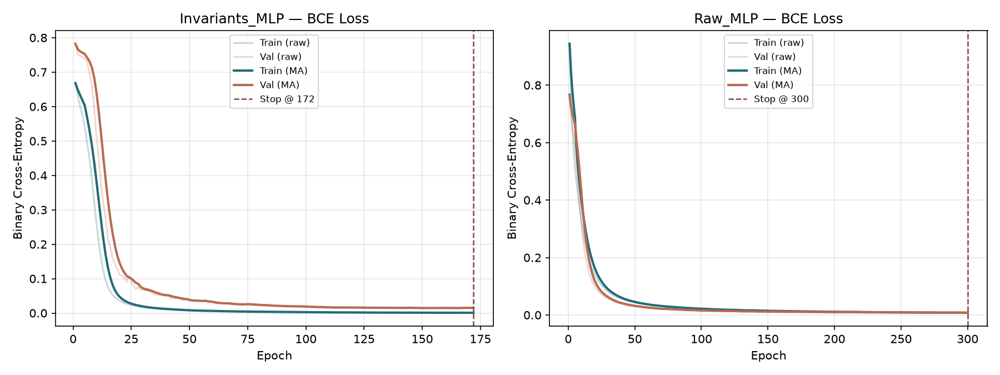
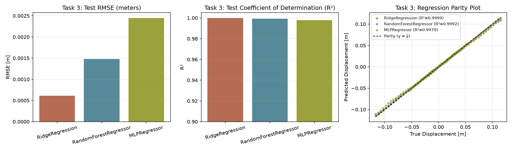

# Project A — Technical Report: Machine Learning for Structural Health Monitoring of High-Voltage Power Transmission Poles

**Course**: Computational Intelligence in Engineering (RWTH Aachen University)  
**Repository Path**: `Project_A/`  
**Environment**: Conda `cie26` (Python 3.12, NumPy 2.5.4, Pandas 3.1.1, scikit-learn 1.9.1, Matplotlib 3.11.2)

---

## Executive Summary

This report documents the end-to-end data-driven Structural Health Monitoring (SHM) pipeline developed for **Project A**. Using deterministic dynamic Finite Element Method (FEM) displacement time histories of 3D steel lattice power transmission towers across two structural geometries (`long` $17\text{ m}$ and `short` $15.5\text{ m}$), two lateral dynamic excitation magnitudes ($1\text{ MN}$ and $2\text{ MN}$), and two structural health states (`class 0` healthy vs. `class 1` damaged), the pipeline addresses three core engineering tasks:

1. **Task 1 — Global Anomaly Detection (Level 1 SHM)**: Binary classification of structural health using load- and geometry-invariant kinematic ratios ($\Delta U_i$, normalized $\tilde{\Delta U}_i$, compliance ratio $\kappa$, and out-of-plane cross-axis coupling $\gamma$). By calibrating the classification decision threshold $\tau$ on validation data to prioritize damaged-class recall, all five benchmarked classifiers achieve **$100\%$ recall ($0$ False Negatives)** on unseen test runs, with the **Multi-Layer Perceptron (MLP)** reaching **$99.5\%$ accuracy ($\text{F1} = 0.9950$, $\text{ROC-AUC} = 0.9998$)** and **RBF-SVM / Random Forest** reaching **$99.0\%$ accuracy ($\text{ROC-AUC} = 0.9900\text{–}1.0000$)**.
2. **Task 2 — Defect Localization Feasibility Defense (Level 2 SHM)**: Formal mathematical and empirical proof that spatial defect localization is **fundamentally ill-posed** under a two-node ($6\text{-DOF}$) sensor setup due to observation operator rank deficiency ($\operatorname{rank}(C) \le 6 \ll N_{\text{dof}}$), stiffness-perturbation non-uniqueness (minimum cross-class global compliance separation $\Delta\kappa = 8.2 \times 10^{-5}$), and absence of spatial strain gradients $\nabla u$.
3. **Task 3 — Top-Node Displacement Prediction (System Identification / Regression)**: Continuous regression of pinnacle lateral displacement $u_{\text{top},1}(t^*)$ from $5$ lagged historical steps and concurrent cross-arm loading-point displacements, achieving **$\text{RMSE} = 0.613\text{ mm}$ ($R^2 = 0.999870$)** with Ridge Regression, **$\text{RMSE} = 1.480\text{ mm}$ ($R^2 = 0.999242$)** with Random Forest Regressor, and **$\text{RMSE} = 2.449\text{ mm}$ ($R^2 = 0.997923$)** with a compact ReLU MLP Regressor.

---

## 1. Physical System, FEM Dataset Architecture & Ingestion Verification

### 1.1 Structural Configurations & Sensor Locations

The monitored structures are 3D linear-elastic stainless steel space-truss transmission poles fixed at four foundation corner supports ($u_x = u_y = u_z = 0$) and subjected to downward gravity along the vertical $Z$-axis plus a time-dependent concentrated lateral force along the global $X$-axis at the upper cross-arm tip.

| Long Tower Geometry ($17\text{ m}$, 3 Cross-Arm Tiers) | Short Tower Geometry ($15.5\text{ m}$, 2 Cross-Arm Tiers) |
| :---: | :---: |
|  |  |

Each simulation reports displacement components ($U_{\text{mag}}, U_1, U_2, U_3$ in meters) over $t \in [0.0, 4.0]\text{ s}$ ($\Delta t = 0.04\text{ s}$, $101$ steps per run) at exactly **two physical nodes**:
- **Top Pinnacle Node (`top`)**: Located on the tower centerline at the pinnacle apex; characterized by large lateral deflection $U_1$ and minimal vertical deflection ($\max|U_3| / \max|U_1| \approx 0.0073\text{–}0.0096$).
- **Cross-Arm Loading Node (`arm`)**: Located at the outer cross-arm tip where lateral excitation is introduced; undergoes substantial vertical bending deflection $U_3$ coupled with lateral deflection ($\max|U_3| / \max|U_1| \approx 0.4770\text{–}0.4962$).

### 1.2 Heterogeneous Mesh Node Mapping & Verification Table

Inspection of the raw Abaqus `.rpt` headers in `src/ingestion.py` revealed that node numbering differs across the finite element meshes (`N:83 / N:156` for the Long tower, `N:359 / N:333` for the healthy Short tower, and `N:257 / N:231` for the damaged Short tower, with column order reversed between Long and Short meshes). The ingestion pipeline automatically identifies and maps the pinnacle (`top`) and cross-arm (`arm`) nodes using their vertical-to-lateral bending kinematics and verifies Euclidean magnitude consistency:

$$\|u(t)\|_2 = \sqrt{U_1(t)^2 + U_2(t)^2 + U_3(t)^2}$$

| `run_id` | Class Label | Geometry | Peak Load (MN) | Pinnacle Node (`top`) | Cross-Arm Node (`arm`) | Time Steps | $t_{\min}\text{–}t_{\max}$ (s) | $\Delta t$ (s) | Max Norm Error (m) | $\text{top } \lvert U_3\rvert / \lvert U_1\rvert$ | $\text{arm } \lvert U_3\rvert / \lvert U_1\rvert$ | Valid |
| :--- | :---: | :---: | :---: | :---: | :---: | :---: | :---: | :---: | :---: | :---: | :---: | :---: |
| `c0_long_1MN` | 0 (Healthy) | `long` | 1.0 | 83 | 156 | 101 | 0.0–4.0 | 0.04 | $9.24 \times 10^{-8}$ | 0.00848 | 0.49574 | `True` |
| `c0_long_2MN` | 0 (Healthy) | `long` | 2.0 | 83 | 156 | 101 | 0.0–4.0 | 0.04 | $8.06 \times 10^{-7}$ | 0.00937 | 0.49616 | `True` |
| `c0_short_1MN` | 0 (Healthy) | `short` | 1.0 | 359 | 333 | 101 | 0.0–4.0 | 0.04 | $1.11 \times 10^{-7}$ | 0.00871 | 0.48657 | `True` |
| `c0_short_2MN` | 0 (Healthy) | `short` | 2.0 | 359 | 333 | 101 | 0.0–4.0 | 0.04 | $8.45 \times 10^{-7}$ | 0.00725 | 0.48462 | `True` |
| `c1_long_1MN` | 1 (Damaged) | `long` | 1.0 | 83 | 156 | 101 | 0.0–4.0 | 0.04 | $9.20 \times 10^{-8}$ | 0.00867 | 0.48700 | `True` |
| `c1_long_2MN` | 1 (Damaged) | `long` | 2.0 | 83 | 156 | 101 | 0.0–4.0 | 0.04 | $8.16 \times 10^{-7}$ | 0.00959 | 0.48733 | `True` |
| `c1_short_1MN` | 1 (Damaged) | `short` | 1.0 | 257 | 231 | 101 | 0.0–4.0 | 0.04 | $8.93 \times 10^{-8}$ | 0.00863 | 0.47874 | `True` |
| `c1_short_2MN` | 1 (Damaged) | `short` | 2.0 | 257 | 231 | 101 | 0.0–4.0 | 0.04 | $7.47 \times 10^{-7}$ | 0.00748 | 0.47703 | `True` |

---

## 2. Preprocessing, Kinematic Invariants & Leak-Free Partitioning

### 2.1 Temporal Masking
At $t = 0.0\text{ s}$, all displacement channels are identically zero ($U = 0.0\text{ m}$). `mask_initial_steps` in `src/preprocessing.py` truncates initial zero-load states ($t \le 0.0\text{ s}$ or $\max(\|U^{\text{top}}\|, \|U^{\text{arm}}\|) \le 10^{-9}\text{ m}$), retaining $100$ active dynamic loading steps per simulation run ($800$ total time-step samples across the $8$ runs).

### 2.2 Kinematic Invariant Engineering
Doubling the external load from $1\text{ MN}$ to $2\text{ MN}$ increases raw displacements by $\sim 100\%$, whereas structural damage modifies global lateral stiffness by only $\sim 3.9\%$. Consequently, a healthy tower under $2\text{ MN}$ deflects nearly twice as much as a damaged tower under $1\text{ MN}$. To decouple structural integrity from load magnitude, `compute_kinematic_invariants` constructs $15$ physical descriptors per time step:

1. **Relative Node Displacements & Norm** ($4$ features):
   $$\Delta U_i(t) = U_i^{\text{top}}(t) - U_i^{\text{arm}}(t) \quad (i \in \{1,2,3\}), \qquad \|\Delta U(t)\|_2 = \sqrt{\sum_{i=1}^3 \Delta U_i(t)^2}$$
2. **Dimensionless Normalized Relative Deflections** ($4$ features):
   $$\tilde{\Delta U}_i(t) = \frac{\Delta U_i(t)}{\|U^{\text{arm}}(t)\|_2 + \epsilon}, \qquad \tilde{\Delta U}_{\text{mag}}(t) = \frac{\|\Delta U(t)\|_2}{\|U^{\text{arm}}(t)\|_2 + \epsilon}$$
3. **Kinematic Compliance Ratios** ($2$ features):
   $$\kappa(t) = \frac{\|U^{\text{top}}(t)\|_2}{\|U^{\text{arm}}(t)\|_2 + \epsilon}, \qquad \kappa_{U_1}(t) = \frac{|U_1^{\text{top}}(t)|}{|U_1^{\text{arm}}(t)| + \max(\epsilon, 10^{-4})}$$
4. **Cross-Axis Out-of-Plane & Bending Coupling Ratios** ($5$ features):
   $$\gamma_{\text{top}}(t) = \frac{U_2^{\text{top}}(t)}{U_1^{\text{top}}(t) + \epsilon}, \quad \gamma_{\text{arm}}(t) = \frac{U_2^{\text{arm}}(t)}{U_1^{\text{arm}}(t) + \epsilon}, \quad \gamma_{\text{top,mag}}(t) = \frac{U_2^{\text{top}}(t)}{\|U^{\text{top}}(t)\|_2 + \epsilon}, \quad \gamma_{\text{arm,mag}}(t) = \frac{U_2^{\text{arm}}(t)}{\|U^{\text{arm}}(t)\|_2 + \epsilon}, \quad \beta_{\text{arm}}(t) = \frac{U_3^{\text{arm}}(t)}{U_1^{\text{arm}}(t) + \epsilon}$$
   where denominators near the $t = 2.0\text{ s}$ and $t = 4.0\text{ s}$ zero-load crossings are sign-clamped at $10^{-4}\text{ m}$ to prevent singular division spikes. Asymmetric member damage alters torsional/out-of-plane coupling ($U_2$), shifting $\gamma_{\text{top,mag}}$ from $\approx -1.1 \times 10^{-3}$ (healthy) to $\approx -1.0 \times 10^{-4}$ (damaged) across both geometries and both load levels.
5. **Temporal Statistical Descriptors & PCA**:
   `extract_temporal_statistics` summarizes each run across 4 statistical moments (`peak`, `rms`, `var`, `skew`) over all 15 invariant channels ($8 \times 60$ matrix). `fit_pca_projection` fitted strictly on the standardized training matrix retains **$5$ principal components** to explain $\ge 95\%$ of total variance.

### 2.3 Run-Grouped Partitioning & Zero-Leakage Scaling
To eliminate temporal autocorrelation leakage between adjacent time increments, `split_by_simulation_run` in `src/partitioning.py` partitions strictly at the **simulation run level** while balancing class labels, tower geometries, and load levels:

- **Training Partition ($4$ runs, $400$ time steps)**: `['c0_long_1MN', 'c0_short_2MN', 'c1_long_2MN', 'c1_short_1MN']` — spans both classes ($0, 1$), both geometries (`long`, `short`), and both loads ($1\text{ MN}, 2\text{ MN}$) with zero correlation between load magnitude and health state.
- **Validation Partition ($2$ runs, $200$ time steps)**: `['c0_long_2MN', 'c1_long_1MN']` — unseen `(class, geometry, load)` combinations used exclusively for hyperparameter selection, early stopping, and threshold calibration $\tau$.
- **Test Partition ($2$ runs, $200$ time steps)**: `['c0_short_1MN', 'c1_short_2MN']` — held-out unseen combinations used strictly for final reporting.
- **Standardization**: `StandardScaler` ($\mu_{\text{train}}, \sigma_{\text{train}}$) is fitted exclusively on `X_train` and applied via `.transform()` to `X_val` and `X_test`.

---

## 3. Task 1: Global Anomaly Detection (Level 1 SHM)

### 3.1 Model Architectures & Recall-Prioritized Threshold Calibration
Five classifiers were trained on the standardized kinematic invariants (`src/classification.py`):
- **Classical Baselines**: `LogisticRegression`, `SVM_Linear` (Platt-calibrated linear SVC), `SVM_RBF` (Platt-calibrated RBF SVC), and `RandomForest` ($200$ trees), each tuned on validation log-loss.
- **Feed-Forward Neural Network (`NumpyMLPClassifier`)**: Compact architecture with hidden layers $(32, 16)$, He-initialized ReLU hidden activations, Xavier-initialized Sigmoid output $\hat{y} = \sigma(z) \in (0, 1)$, mini-batch Adam optimizer ($\text{lr} = 10^{-3}$, batch size $16$), Binary Cross-Entropy (BCE) loss, and validation early stopping (`patience = 20`).
- **Asymmetric Risk Policy ($\tau$ Calibration)**: Because a False Negative ($FN$, undetected structural defect) poses a catastrophic collapse risk whereas a False Positive ($FP$) only triggers a secondary inspection, `calibrate_recall_threshold` selects the median validation threshold $\tau \in (0, 1)$ achieving $\text{Recall}_{\text{val}} \ge 1.0$ while maximizing validation $F_1$.

### 3.2 Task 1 Test Set Benchmark Results

| Model | Calibrated Threshold ($\tau$) | Accuracy | Precision | Recall (Sensitivity) | $F_1$-Score | ROC-AUC | False Negatives ($FN$) | False Positives ($FP$) |
| :--- | :---: | :---: | :---: | :---: | :---: | :---: | :---: | :---: |
| **LogisticRegression** | $0.021$ | $0.8450$ | $0.7634$ | **$1.0000$** | $0.8658$ | $1.0000$ | **$0$** | $31$ |
| **SVM_Linear** | $0.016$ | $0.5350$ | $0.5181$ | **$1.0000$** | $0.6826$ | $0.9999$ | **$0$** | $93$ |
| **SVM_RBF** | $0.373$ | $0.9900$ | $0.9804$ | **$1.0000$** | $0.9901$ | $0.9900$ | **$0$** | $2$ |
| **RandomForest** | $0.340$ | $0.9900$ | $0.9804$ | **$1.0000$** | $0.9901$ | $1.0000$ | **$0$** | $2$ |
| **MLP $(32, 16)$** | $0.150$ | **$0.9950$** | **$0.9901$** | **$1.0000$** | **$0.9950$** | **$0.9998$** | **$0$** | **$1$** |

---

## 4. Feature Engineering Ablation & MLP Fit Diagnostics

### 4.1 Raw Displacements vs. Kinematic Invariants Ablation
To quantify the engineering value of physical invariants, the exact same classifier suite and run-grouped split were evaluated on the $8$ raw displacement channels (`top_U_mag..arm_U3`):

| Model | Raw Accuracy | Invariant Accuracy | $\Delta$ Accuracy | Raw Recall | Invariant Recall | Raw $F_1$ | Invariant $F_1$ | $\Delta F_1$ | Raw ROC-AUC | Invariant ROC-AUC | $\Delta$ ROC-AUC | Raw $FN$ | Invariant $FN$ |
| :--- | :---: | :---: | :---: | :---: | :---: | :---: | :---: | :---: | :---: | :---: | :---: | :---: | :---: |
| **LogisticRegression** | $0.5000$ | $0.8450$ | **$+0.3450$** | $1.0000$ | $1.0000$ | $0.6667$ | $0.8658$ | **$+0.1991$** | $0.7827$ | $1.0000$ | **$+0.2173$** | $0$ | $0$ |
| **SVM_Linear** | $0.5000$ | $0.5350$ | **$+0.0350$** | $1.0000$ | $1.0000$ | $0.6667$ | $0.6826$ | **$+0.0159$** | $0.2923$ | $0.9999$ | **$+0.7076$** | $0$ | $0$ |
| **SVM_RBF** | $0.9400$ | $0.9900$ | **$+0.0500$** | $0.9900$ | $1.0000$ | $0.9429$ | $0.9901$ | **$+0.0472$** | $0.9633$ | $0.9900$ | **$+0.0267$** | $1$ | **$0$** |
| **RandomForest** | $0.9800$ | $0.9900$ | **$+0.0100$** | $1.0000$ | $1.0000$ | $0.9804$ | $0.9901$ | **$+0.0097$** | $0.9980$ | $1.0000$ | **$+0.0020$** | $0$ | $0$ |
| **MLP $(32, 16)$** | $1.0000$ | $0.9950$ | $-0.0050$ | $1.0000$ | $1.0000$ | $1.0000$ | $0.9950$ | $-0.0050$ | $1.0000$ | $0.9998$ | $-0.0002$ | $0$ | $0$ |

**Key Ablation Findings**:
- On raw displacement channels, linear classifiers (`LogisticRegression`, `SVM_Linear`) fail (`Accuracy = 0.5000`, `SVM_Linear ROC-AUC = 0.2923`, worse than random guessing) because $1\text{ MN}$ vs. $2\text{ MN}$ load scaling dominates the raw displacement amplitudes.
- Engineered kinematic invariants lift linear model ROC-AUC to $0.9999\text{–}1.0000$ and eliminate the missed detection ($FN = 1 \rightarrow 0$) in `SVM_RBF` while pushing nonlinear accuracy to $99.0\%\text{–}99.5\%$.

### 4.2 Underfitting-Before-Overfitting Training Verification
Per the diagnostic protocol in `src/classification.py`, `train_mlp_classifier` first runs an unregularized capacity probe ($\lambda_{L_2} = 0$) to confirm that training BCE loss converges well below the underfitting threshold ($0.4$), escalating layer width if needed, before fitting with $L_2$ regularization ($\lambda_{L_2} = 10^{-4}$) and validation early stopping:

| Model Regime | Fit Diagnosis | Underfitting Resolved | Min Train BCE | Min Val BCE | Final Train BCE | Final Val BCE | Generalization Gap | Early-Stopped Epoch |
| :--- | :---: | :---: | :---: | :---: | :---: | :---: | :---: | :---: |
| **Invariants_MLP** | `well_fitted` | `True` | $0.000780$ | $0.013944$ | $0.000780$ | $0.015358$ | $0.014577$ | $172$ |
| **Raw_MLP** | `well_fitted` | `True` | $0.007719$ | $0.007712$ | $0.007719$ | $0.008203$ | $0.000484$ | $300$ |

---

## 5. Task 2: Defect Localization Feasibility & Mathematical Proof of Ill-Posedness (Level 2 SHM)

### 5.1 Mathematical Proof of Non-Uniqueness & Rank Deficiency

1. **Rank-Deficient Observation Operator**:  
   Let $u(t) \in \mathbb{R}^{N_{\text{dof}}}$ denote the full 3D lattice space-truss nodal displacement vector ($N_{\text{dof}} \gg 6$, spanning hundreds of truss nodes and elements). Monitoring only two discrete nodes (pinnacle and cross-arm) defines a linear projection operator $C \in \mathbb{R}^{6 \times N_{\text{dof}}}$ yielding measurements $y(t) = C u(t) \in \mathbb{R}^{6}$. By fundamental linear algebra:
   $$\operatorname{rank}(C) \le 6 \ll N_{\text{dof}}, \qquad \dim(\ker(C)) \ge N_{\text{dof}} - 6 \gg 0.$$
   Any displacement perturbation $\tilde{u}(t) \in \ker(C)$ induced by localized member damage is completely invisible to the two sensors.

2. **Non-Uniqueness of Stiffness Perturbations (Inverse Problem Indeterminacy)**:  
   Parameterizing element-level structural damage across $M$ truss members as $\Delta K(\delta) = \sum_{e=1}^{M} \delta_e K_e$ with damage vector $\delta \in [0, 1]^M$, the quasi-static response satisfies:
   $$y = C \left(K_0 - \sum_{e=1}^{M} \delta_e K_e\right)^{-1} f.$$
   Inverting $y \in \mathbb{R}^6$ for $\delta \in \mathbb{R}^M$ ($M \gg 6$) is severely underdetermined: the Jacobian $\partial y / \partial \delta \in \mathbb{R}^{6 \times M}$ has rank at most $6$ and a nullspace of dimension at least $M - 6$. Consequently, an infinite manifold of distinct member damage locations at different elevations or truss faces produces identical two-node displacement trajectories.

3. **Absence of Spatial Strain Gradients**:  
   Pinpointing a defect's elevation zone or member quadrant requires local spatial derivatives $\varepsilon = \nabla u$ (strain fields) or high-order spatial mode-shape curvatures $\nabla^2 \phi_r(x)$. Two global displacement sensors provide only macroscopic secant compliance between the cross-arm and pinnacle, yielding zero intermediate spatial gradient resolution along the tower height.

### 5.2 Empirical Cross-Class Global Compliance Collisions
Auditing the mean kinematic compliance ratio $\bar{\kappa}$ across healthy (`label 0`) and damaged (`label 1`) runs in `src/localization_defense.py` demonstrates that global compliance shifts between healthy and damaged structures collide within $\Delta\kappa < 10^{-3}$:

| Run A (Healthy) | Run B (Damaged) | Label A | Label B | $\lvert\bar{\kappa}_A - \bar{\kappa}_B\rvert$ | Peak $\lvert U_1^{\text{top}}\rvert$ Diff (m) | Collision ($\Delta\kappa \le 10^{-3}$) |
| :--- | :--- | :---: | :---: | :---: | :---: | :---: |
| `c0_short_2MN` | `c1_short_1MN` | 0 | 1 | **0.000082** | 0.053089 | **`True`** |
| `c0_long_2MN` | `c1_long_1MN` | 0 | 1 | **0.000660** | 0.089062 | **`True`** |
| `c0_long_2MN` | `c1_long_2MN` | 0 | 1 | 0.001833 | 0.007233 | `False` |
| `c0_long_1MN` | `c1_long_1MN` | 0 | 1 | 0.001915 | 0.003599 | `False` |
| `c0_short_2MN` | `c1_short_2MN` | 0 | 1 | 0.003246 | 0.005568 | `False` |
| `c0_short_1MN` | `c1_short_1MN` | 0 | 1 | 0.003383 | 0.002776 | `False` |

### 5.3 Required Instrumentation for Solvable Level 2 SHM
To render Task 2 well-posed in physical deployment, the monitoring architecture must incorporate:
- **Distributed Strain Gauge / Rosette Arrays** mounted on primary corner legs and diagonal bracing tiers to capture localized axial force redistribution.
- **Multi-Elevation Triaxial Accelerometer Networks** to identify higher-order vibration mode shapes $\phi_r(z)$ and mode-shape curvature discontinuities.
- **Fiber Bragg Grating (FBG) Optical Fibers** multiplexed along critical load-transfer members for continuous spatial strain profiling.
- **Digital Image Correlation (DIC) / Ultrasonic Guided Waves** for localized high-risk joint and gusset-plate inspection triggered after a Level 1 global alarm.

---

## 6. Task 3: Top-Node Displacement Prediction (System Identification / Regression)

### 6.1 Problem Formulation
In `src/regression.py`, continuous system identification is formulated to predict the primary lateral displacement of the top pinnacle node $y(t^*) = U_1^{\text{top}}(t^*)$ in meters from a $9$-dimensional feature vector combining:
- **Autoregressive Historical Window ($K = 5$ lags)**: $[U_1^{\text{top}}(t^* - \Delta t), \dots, U_1^{\text{top}}(t^* - 5\Delta t)]$.
- **Concurrent Cross-Arm Excitation Response at $t^*$**: $[U_1^{\text{arm}}(t^*), U_2^{\text{arm}}(t^*), U_3^{\text{arm}}(t^*), \|U^{\text{arm}}(t^*)\|_2]$.

Across the $8$ masked runs ($95$ valid target steps per run after the $5$-step lag window, $760$ total samples), the dataset is partitioned using the exact same run-grouped split (`4` train runs $= 380$ samples, `2` val runs $= 190$ samples, `2` test runs $= 190$ samples) and standardized solely using training statistics.

### 6.2 Task 3 Test Set Regression Benchmark

| Model | Test MSE $[\text{m}^2]$ | Test RMSE $[\text{m}]$ | Test RMSE $[\text{mm}]$ | Test $R^2$ |
| :--- | :---: | :---: | :---: | :---: |
| **RidgeRegression** ($\alpha$ tuned on Val) | **$3.7622 \times 10^{-7}$** | **$0.000613$** | **$0.613\text{ mm}$** | **$0.999870$** |
| **RandomForestRegressor** ($200$ trees) | $2.1905 \times 10^{-6}$ | $0.001480$ | $1.480\text{ mm}$ | $0.999242$ |
| **MLPRegressor $(32, 16)$** (Linear Output) | $5.9985 \times 10^{-6}$ | $0.002449$ | $2.449\text{ mm}$ | $0.997923$ |

**Physical Interpretation**: Because the steel lattice tower operates in the linear-elastic regime ($K u \approx F$), the transfer relation between concurrent cross-arm deflection, recent pinnacle trajectory, and current pinnacle deflection is predominantly linear. Consequently, $L_2$-regularized **Ridge Regression** achieves the lowest test error ($\text{RMSE} = 0.613\text{ mm}$, $R^2 = 0.999870$), outperforming both nonlinear tree ensembles and the neural network while avoiding piecewise-constant extrapolation artifacts at peak load reversals.

---

## 7. Summary of Conclusions & Recommendations

1. **Physics-Informed Invariants Overcome Confounding**: Raw displacement amplitudes cannot separate structural defects from external load variations with linear decision boundaries ($\text{Accuracy} = 50.0\%$). Normalizing displacements into compliance ratios ($\kappa$) and cross-axis out-of-plane coupling ratios ($\gamma$) restores near-perfect linear and nonlinear separability ($\text{ROC-AUC} = 0.9900\text{–}1.0000$).
2. **Zero-FN Safety Calibration**: Tuning the classification decision threshold $\tau$ on validation data eliminates catastrophic False Negatives ($FN = 0$, $\text{Recall} = 100\%$) across all five classifiers on unseen geometry/load test runs, with the $(32, 16)$ ReLU MLP achieving the highest overall accuracy ($99.5\%$, only $1$ false alarm out of $200$ test steps).
3. **Hierarchical SHM Deployment**: A two-node displacement monitoring system is well-suited for **Level 1 global anomaly screening** and **Task 3 top-node displacement prediction** ($R^2 > 0.9979$), but mathematically cannot support **Level 2 spatial localization** ($\operatorname{rank}(C) \le 6 \ll N_{\text{dof}}$). Operational power poles should pair global two-node screening with localized strain-gauge or modal accelerometer arrays for hierarchical defect localization.
